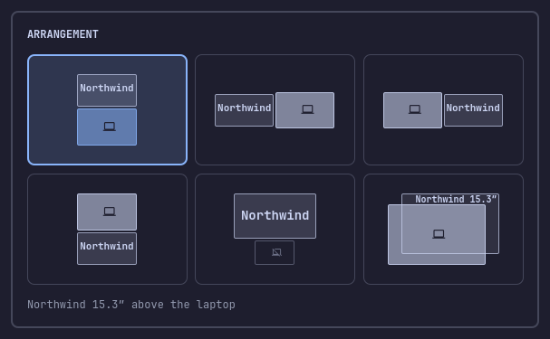
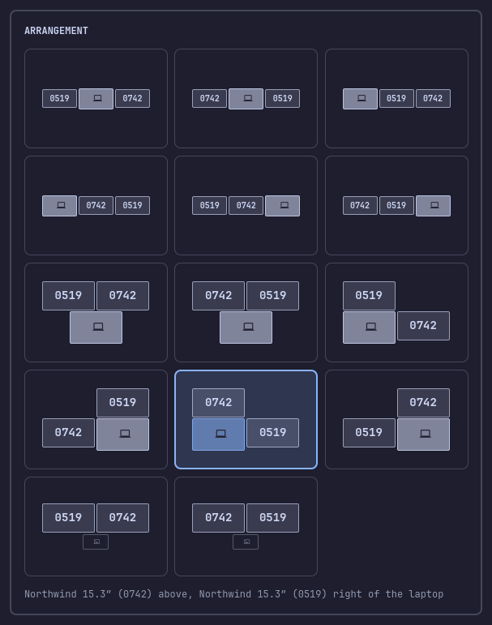

# omarchy-display-arranger

An [Omarchy](https://omarchy.org) bar widget: a popup with one tile per
arrangement of the displays connected now. Click a tile and it is applied live
and kept across reloads and reboots.





The highlighted tile is the arrangement on screen now, read from Hyprland.
Arrow keys or `hjkl` move a cursor, Enter applies, Esc closes. Two identical
displays are told apart by the last four characters of their serials.

## Requirements

- Omarchy with Hyprland 0.56 or later and the Lua config (`~/.config/hypr/monitors.lua`).
- A laptop panel plus one or two external displays, or two externals alone.

## Install, update, uninstall

```bash
omarchy plugin add https://github.com/jordi-adame/omarchy-display-arranger.git --enable
omarchy plugin enable jordi-adame.display-arranger --section right --after omarchy.monitor   # optional: next to the Display icon
omarchy plugin update jordi-adame.display-arranger
```

Uninstall in this order; Hyprland reports a config error if the `require` line
outlives the file it loads.

1. If a laptop-off or mirror tile is active, click an extended tile first.
2. Remove the two lines the plugin added to `monitors.lua`:

   ```bash
   sed -i -e '/^-- Display arrangement from the jordi-adame.display-arranger bar widget/d' \
          -e '/^require("hypr.display-arrangement")$/d' ~/.config/hypr/monitors.lua
   ```

3. `rm -f ~/.config/hypr/display-arrangement.lua`
4. `omarchy plugin remove jordi-adame.display-arranger`

## How a click is kept

A click writes `~/.config/hypr/display-arrangement.lua` (tmp + rename) and, the
first time, appends `require("hypr.display-arrangement")` with a comment to the
end of `monitors.lua`, after copying it to `monitors.lua.bak.<stamp>`. A
`monitors.lua` that already has the line, is missing or is read-only is left
alone, and the popup says so. Actions are logged to
`~/.local/state/display-arranger/apply.log`.

The file stores only the arrangement and the displays (by description, so it
follows the monitor, not the port). Scale, mode and transform are read from
`monitors.lua` at config load, so a scale picked in Omarchy's Display panel
takes effect after any click. Laptop off and mirror use Omarchy's own toggles,
so its Display panel and clamshell handling keep working.

**Last click only:** the file remembers one arrangement. Displays it does not
name fall back to their `monitors.lua` rules.

## Known limits

- An Omarchy scale of `"auto"` (the default for the laptop) cannot be read from `monitors.lua`; the plugin uses the scale the display runs at when you click and records it in the file as a fallback. Pick a scale in the Display panel to pin it.
- More than two external displays: no tiles.
- Last click only can leave an off-center position after unplugging a display, until the next click.
- The two-external tiles are tested less than the one-external ones.

## Rule order in monitors.lua

Hyprland applies the last `hl.monitor` rule that matches a display; the
catch-all (`output = ""`) is only a fallback. Omarchy's Display panel writes an
external's scale as a rule right after the catch-all, so a hand-written `desc:`
rule placed after the catch-all beats it and the panel's scale never sticks.
Keep hand rules before the catch-all.

## Mirror and laptop-off close the popup first

Both take an output away, and an Omarchy popup open on an output that goes
away can crash the shell (Quickshell re-creates a window on the dying screen).
So these two tiles close the popup, wait for it to unmap, then run.

## Dry run

An empty file named `DRY_RUN` next to the installed `apply.sh`
(`~/.config/omarchy/plugins/jordi-adame.display-arranger/v1/DRY_RUN`) makes
clicks log what they would do without changing anything.

Strings are English only (`v1/i18n/en.json`); translations welcome. See
[CONTRIBUTING.md](CONTRIBUTING.md). License: [MIT](LICENSE).
