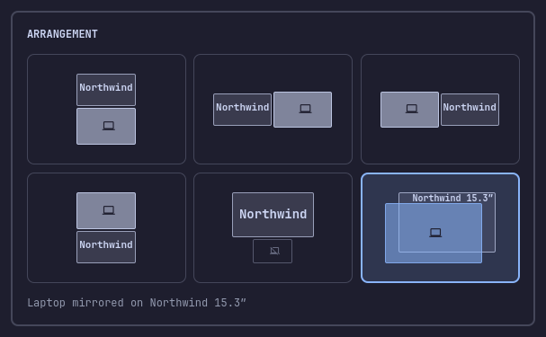

# omarchy-display-arranger

An [Omarchy](https://omarchy.org) shell bar widget. Its bar icon opens a popup
with a grid of tiles, one for each arrangement possible with the displays
connected now. Click a tile: the arrangement is applied live and kept after a
Hyprland reload or a reboot.


With a laptop and one external display the tiles are: the external above, left,
right or below the laptop (centered on the shared edge), the external alone with
the laptop off, and the laptop mirrored on the external. The highlighted tile is
the arrangement on screen now, read from Hyprland itself. The arrow keys or
`hjkl` move a cursor over the tiles, Enter applies, Esc closes.


With two externals there are fourteen tiles: every left-to-right order, both
externals above the laptop side by side, one above and one beside, and the two
externals side by side with the laptop off. Two identical displays are told
apart by the last four characters of their serials; different displays show
their brand.



## Requirements

- Omarchy with Hyprland 0.56 or later and the Lua config (`~/.config/hypr/monitors.lua`).
- A laptop panel (`eDP-*`, `LVDS-*` or `DSI-*`) plus one or two externals, or two externals alone.

## Install

```bash
omarchy plugin add https://github.com/jordi-adame/omarchy-display-arranger.git --enable
```

The widget lands in the right section of the bar. To put it next to Omarchy's
own Display icon instead:

```bash
omarchy plugin enable jordi-adame.display-arranger --section right --after omarchy.monitor
```

Update:

```bash
omarchy plugin update jordi-adame.display-arranger
```

## How a click is kept

A click writes `~/.config/hypr/display-arrangement.lua` (atomically, a temp file
renamed over the old one) and, the first time, makes `~/.config/hypr/monitors.lua`
load it: `monitors.lua` is copied to `monitors.lua.bak.<YYYYmmdd-HHMMSS>` and two
lines are appended at its end, once:

```lua
-- Display arrangement from the jordi-adame.display-arranger bar widget. Keep this the last line.
require("hypr.display-arrangement")
```

A `monitors.lua` that already requires the file (by hand, say) is left alone; one
that is missing or not writable is left alone too, and the popup says so, so you
can add the line yourself. The plugin never touches `monitors.lua` otherwise.
Every action is logged to `~/.local/state/display-arranger/apply.log`.

The generated file holds the arrangement (which tile, which displays by
description) and nothing else: no scale, mode, transform or position. A small
loader in the file reads those from `monitors.lua` at config load, with
Hyprland's own rule precedence, and computes the positions from the logical
sizes they give. So a scale picked in Omarchy's Display panel takes effect after
any tile click, and a click made while Omarchy's mirror or laptop-off toggle is
on cannot freeze the toggle's temporary scale into the file. Hyprland watches the
file and reloads when it changes.

Externals are matched by `desc:<description>` (which carries the serial), so an
arrangement follows the monitor, not the port. The laptop sits at `0x0` whenever
it is on and never jumps when an external is unplugged.

**Last click only.** The file remembers one arrangement: the last tile clicked.
Unplug a display and the remaining ones keep the positions that click gave them;
plug a different set in and the displays the file does not name fall back to
their `monitors.lua` rules. A later version may keep one arrangement per set of
connected displays; the file format already allows it.

Laptop off and mirror go through Omarchy's own toggles
(`omarchy-hyprland-monitor-internal` and `omarchy-hyprland-monitor-internal-mirror`),
so Omarchy's Display panel, its clamshell handling and its recovery when the
last external is unplugged all keep working. The generated file still holds
rules for every display with the laptop on; they apply when the toggle is lifted
elsewhere.

## Known limits

- An Omarchy scale of `"auto"` (`local omarchy_monitor_scale = "auto"`) cannot be
  read, so the position maths treat that display as scale 1. Side-by-side tiles
  may then leave a gap or overlap. Pick a scale in Omarchy's Display panel (it
  writes a number) and the positions follow.
- More than two external displays are not covered: the popup shows a note and
  no tiles.
- "Last click only" can leave an off-center position after unplugging a display,
  until the next click.
- The two-external tiles are tested less than the one-external ones.

## Rule order in monitors.lua

Hyprland applies the **last** `hl.monitor` rule that matches a display; the
catch-all rule (`output = ""`) is only a fallback for displays no rule names,
wherever it sits in the file. Omarchy's Display panel persists an external's
scale as a rule by connector name right after the catch-all. So a hand-written
`desc:` rule placed **after** the catch-all beats the panel's rule, and the scale
you pick in the panel never sticks, with or without this plugin. Keep hand
rules before the catch-all; the panel's rule then comes later and wins, and the
plugin's loader, which reads `monitors.lua` with the same precedence, follows
it.

## Why mirror and laptop-off close the popup first

Both tiles take an output away: laptop off disables the panel, and a mirrored
output loses its `wl_output` global. While an Omarchy popup is open on the output
that goes away, with another output left, the shell (Quickshell on Qt) can crash:
the popup window moves to the surviving output, the panel's transparent "dismiss"
window for the vanished output is re-created on the screen Qt is deleting, and
its first configure reads a null screen. This is not specific to the plugin; any
Omarchy panel open on a disappearing output can trigger it. So these two tiles
close the popup, wait for its window to unmap, and only then run the toggle. The
caption reads "Closing the popup first…" meanwhile. Every other tile keeps or
adds outputs and runs at once.

## Dry run

To try the popup without it changing anything, put an empty file named `DRY_RUN`
next to `apply.sh` in the installed copy
(`~/.config/omarchy/plugins/jordi-adame.display-arranger/v1/DRY_RUN`). Clicks
then print what they would run and write to the log only, and the popup says
"Dry run: nothing applied". Remove the file to arm the widget again.

## Uninstall

Do the steps in this order: Hyprland reports a config error if the `require`
line outlives the file it loads.

1. If a laptop-off or mirror tile is active, click an extended tile first, or run
   `omarchy hyprland monitor internal on` and `omarchy hyprland monitor internal mirror off`.
2. Remove the require line and its comment from `monitors.lua`:

   ```bash
   cp ~/.config/hypr/monitors.lua ~/.config/hypr/monitors.lua.bak.$(date +%Y%m%d-%H%M%S)
   sed -i -e '/^-- Display arrangement from the jordi-adame.display-arranger bar widget/d' \
          -e '/^require("hypr.display-arrangement")$/d' ~/.config/hypr/monitors.lua
   ```

   Hyprland reloads, back to the layout `monitors.lua` describes. The backup the
   first click made (`monitors.lua.bak.<stamp>`) is the file as it was before the
   plugin.
3. Delete the generated file: `rm -f ~/.config/hypr/display-arrangement.lua`.
4. Remove the plugin: `omarchy plugin remove jordi-adame.display-arranger`.
5. Optional: `rm -r ~/.local/state/display-arranger`.

## Strings

The strings are English only (`v1/i18n/en.json`). Translations are welcome; see
[CONTRIBUTING.md](CONTRIBUTING.md), which also explains the layout, the tests
and why a change to the QML goes in a new version folder.

## License

[MIT](LICENSE).
